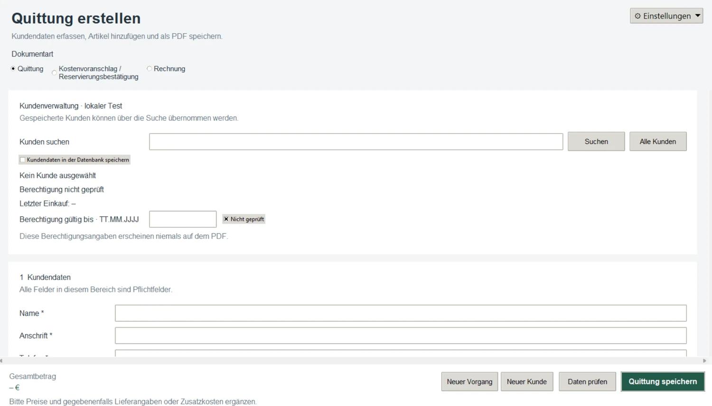
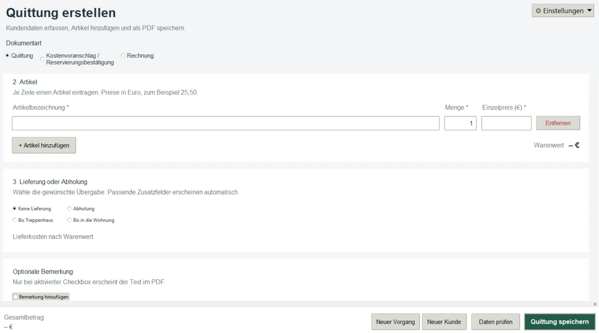

# Quittung

Lokale Python-Desktop-App für **Quittungen, Rechnungen und Kostenvoranschläge mit Reservierungsbestätigung**. Artikel erfassen, Beträge automatisch berechnen und den fertigen Beleg als PDF speichern.



## Funktionen

- **Belege erstellen:** Positionen mit Menge und Einzelpreis erfassen. Die App berechnet Warenwert, Zusatzkosten und Gesamtbetrag.
- **Lieferkosten berechnen:** Wahlweise nach Warenwert, Entfernung oder Volumen. Etagenzuschläge, Fahrstuhlpauschalen und Montagekosten lassen sich berücksichtigen.
- **Reservierungen verwalten:** Gültigkeitsdatum und Anzahlung erfassen. Der Restbetrag wird automatisch berechnet.
- **PDFs exportieren:** Eigene Firmendaten und optionale Bemerkungen übernehmen. Eine hinterlegte Bankverbindung erscheint auf Rechnungen.
- **Kunden wiederverwenden:** Kontaktdaten und Vorgänge bei Bedarf lokal in SQLite speichern. Die Checkbox dafür ist standardmäßig aus.

**Beispiel-PDFs mit fiktiven Daten** · [Quittung](docs/Beispiel-Quittung.pdf) · [Rechnung](docs/Beispiel-Rechnung.pdf) · [Kostenvoranschlag](docs/Beispiel-Kostenvoranschlag.pdf)

<details>
<summary>Artikelerfassung und Lieferoptionen ansehen</summary>



</details>

## Aus dem Quellcode starten

Lade das Repository über **Code → Download ZIP** herunter und entpacke es. Öffne ein Terminal im Ordner, in dem `main.py` liegt. Du brauchst Python 3.10 oder neuer mit Tkinter und eine grafische Desktopumgebung. Auf Debian oder Ubuntu kann je nach Installation das Paket `python3-tk` nötig sein.

**Windows (PowerShell)**

```powershell
py -m venv .venv
.\.venv\Scripts\python.exe -m pip install -r requirements.txt
.\.venv\Scripts\python.exe main.py
```

**macOS und Linux**

```bash
python3 -m venv .venv
.venv/bin/python -m pip install -r requirements.txt
.venv/bin/python main.py
```

## Einen Beleg erstellen

1. Wähle die Dokumentart und trage Kundendaten und Artikel ein.
2. Wähle Lieferung oder Abholung. Unter **⚙ Einstellungen** kannst du eigene Firmendaten und Lieferpreise hinterlegen. Die Warenwerttabelle enthält fiktive Beispielpreise. Beim ersten Speichern der Lieferpreise legst du ein Passwort fest.
3. Aktiviere bei Bedarf **Bemerkung hinzufügen** oder **Kundendaten in der Datenbank speichern**.
4. Prüfe den Vorgang über **Daten prüfen** und speichere anschließend das PDF.

**Neuer Vorgang** leert die Vorgangsdaten und behält den aktuellen Kunden. **Neuer Kunde** leert zusätzlich die Kundenfelder.

## Lokale Daten

| System | Verzeichnis für Kundendaten, Firmendaten und Lieferpreise |
| --- | --- |
| Windows | `%LOCALAPPDATA%\Quittung` |
| macOS | `~/Library/Application Support/Quittung` |
| Linux | `${XDG_DATA_HOME:-$HOME/.local/share}/quittung` |

Die App speichert PDFs am im Dialog gewählten Ort. Mit `QUITTUNG_DB_PATH` lässt sich ein anderer Pfad für die Kundendatenbank festlegen.

## Technik, Tests und Windows-Build

**Python**, **Tkinter**, **ReportLab** und **SQLite**. Lieferpreise und Firmendaten werden als JSON gespeichert.

Für die Tests verwende den Python-Interpreter der virtuellen Umgebung.

```bash
python -m unittest discover -s tests -v
```

Unter Windows kannst du mit der vorhandenen PyInstaller-Spezifikation eine EXE erstellen.

```powershell
.\.venv\Scripts\python.exe -m pip install pyinstaller
.\.venv\Scripts\python.exe -m PyInstaller Quittung.spec
```

Die EXE liegt anschließend unter `dist\Quittung.exe`.
